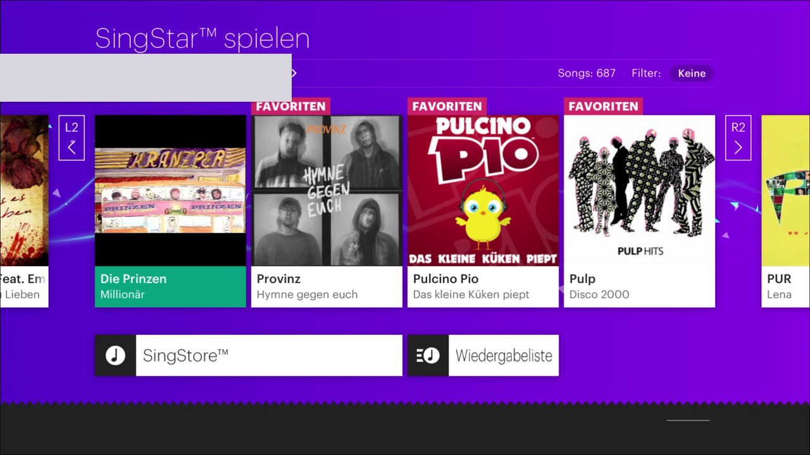
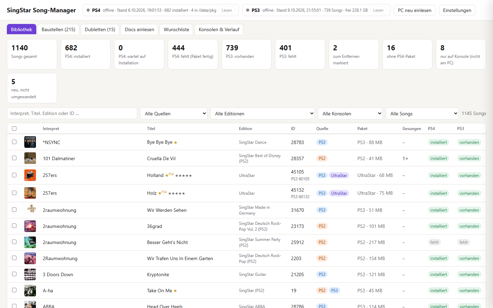
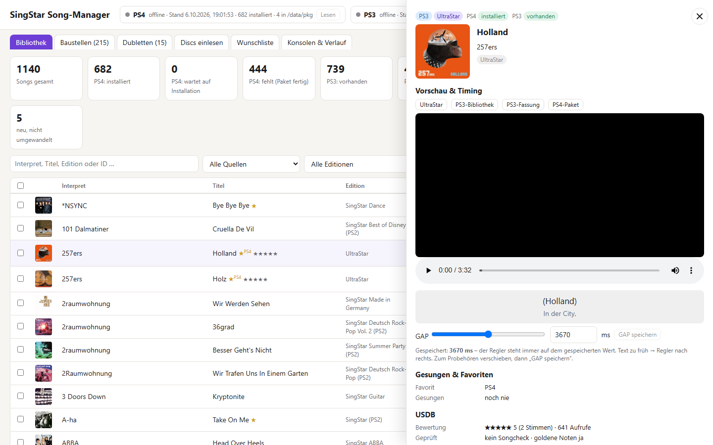
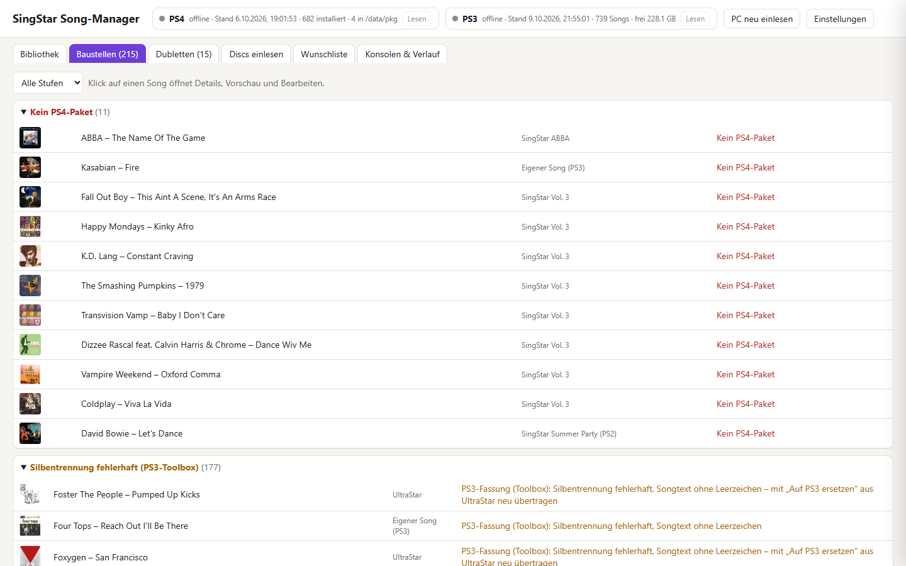
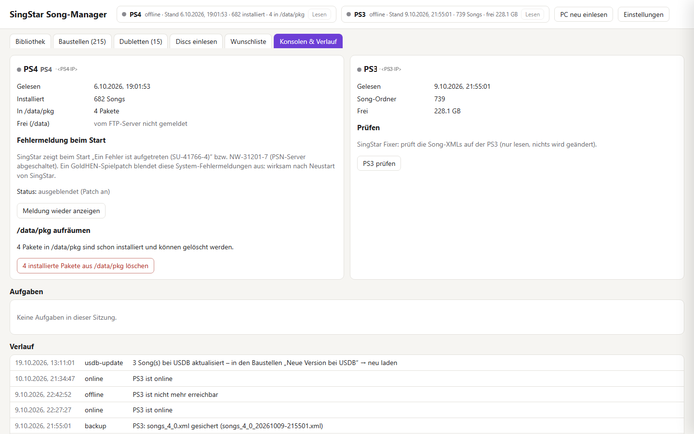

# StarDex

**English** · [Deutsch](README.md)

Your own songs in **SingStar on PS3 and PS4** – plus a song manager that brings your whole collection together on
the PC.

StarDex converts songs from **UltraStar**, the **PS3 SingStar library** and **PS3 and PS2 discs** into the song
format of SingStar PS3 or PS4 and transfers them to the consoles. The songs then show up like official songs – with
lyrics, pitch lines, scoring, video, cover, preview and chorus.

> **Recommendation: PS3.** SingStar runs more smoothly on the PS3. The PS3 version also needs less effort: loose
> files via FTP instead of packages, no GoldHEN patch, no label rules.

> The repository contains **tools only** – no songs, no packages and no Sony files.
> Only use songs you own.

## What it does

| Area | PS3 | PS4 (`CUSA00033`, EU, v01.10) |
|---|---|---|
| UltraStar → console | `tools/to_ps3.py ultrastar` (max. 720p, −10 LUFS) | `tools/us_to_ps4.py` (up to 1080p, −12 LUFS) |
| PS2 disc → console | `tools/to_ps3.py ps2` | `tools/ps2_to_ps4.py` |
| PS3 disc / PS3 library → console | `tools/to_ps3.py ps3disc` (taken over unchanged) | `tools/ps3_to_ps4.py` |
| Transfer | webMAN FTP to `/dev_hdd0/FileSystem/Export`, song lists with backup and check | fPKG via the GoldHEN package installer or disc pack (`Pack0.psarc`) |
| Read favourites, statistics, high scores | yes | yes (while SingStar is running) |

The **song manager** (`manager/`, web app) handles both consoles at once: library, issue list, disc import, USDB
wishlist, building and transferring. Its interface is available in English (Settings → Sprache / Language).
Details in [manager/README.md](manager/README.md) (German).

### How the conversion works

The actual song logic lives in the PS4 converters: converting notes, duet split, chorus, medley, vocal reduction
(ADRS) and loudness. For a PS3 version of UltraStar and PS2 songs, `to_ps3.py` first builds a temporary PS4 pack and
then converts it into the PS3 format. The common key is the song ID: official IDs are the same on all consoles, own
songs get 45xxx (PS4) or 60xxx (PS3).

## Screenshots

Own songs in the song list of SingStar on the PS4:



Song manager – library with all sources and the status per console:



| Song details with preview and timing | Issues (automatic problem list) |
|---|---|
|  |  |

| Consoles & history |
|---|
|  |

## Known issues

- **Crash in the multi-voice battle mode with USDB songs:** if a song downloaded from USDB is sung in battle mode
  with several voices, SingStar can currently crash. Until this is fixed, better avoid these songs in the
  multi-voice battle mode.
- Real UltraStar duets (`P1`/`P2`) and `#RELATIVE` are not supported by the UltraStar converter yet.
- PS4: while Remote Play is connected, SingStar does not let you sing (only affects the developer remote control).

## Quick start

1. Install [Python](https://www.python.org) 3.10+ and [ffmpeg](https://ffmpeg.org) (for the PS4 also the .NET
   runtime).
2. Double-click `start.bat` (Linux/macOS: `./start.sh`) – on first start it sets everything up, offers to download
   PkgTool, scee_london and IPUenc and opens the manager.
3. In the manager, enter your consoles under **Settings**, put UltraStar songs into `songs/ultrastar`, done.

In detail, including console preparation and command line: **[docs/SETUP.en.md](docs/SETUP.en.md)**.

## Important rules

Both consoles:

- **Keep `song_ids.json`:** it holds the IDs assigned to UltraStar songs. Without it, a song gets a new ID on the
  next build and appears twice.

PS3:

- **Do not transfer while someone is singing.** webMAN FTP is easily overloaded. That is why the manager reads from
  and transfers to the PS3 only when you press a button. Restart SingStar after transferring.

PS4:

- **Package label ↔ song ID:** the label of a package must contain the song ID (`tools/songid.py`), otherwise songs
  disappear from the list again. `build_dlc.py` checks this.
- **Do not shorten file names:** upload packages only under their full name `EP9000-CUSA00033_00-<LABEL>.pkg` – a
  renamed package made the PS4 crash during installation.

## Layout

```
manager/          song manager (Flask web app, port 5077)
tools/            converters (PS3/PS4), package building, disc pack, batch runs
tools/dev/        developer tools: eboot analysis, tests, PS4 remote control (remote/)
tools/payload/    GoldHEN payload dl0link (symlink download0/Pack0.psarc)
docs/             setup, technical notes, format description, screenshots
songs/            default place for own songs and disc images (stays local)
song_ids.json     assigned song IDs of the UltraStar songs (created on the first build, stays local)
```

## Documentation

| File | Contents |
|---|---|
| [docs/SETUP.en.md](docs/SETUP.en.md) | Setup in three steps, preparing the consoles, additional programs, command line |
| [docs/FORMAT.md](docs/FORMAT.md) | Song and pack format of SingStar PS4 (`config.xml`, `melody_1.xml`, `.chc`, video) – German |
| [docs/TECHNIK.md](docs/TECHNIK.md) | Technical background: how SingStar loads songs, rules, disc pack, PS3, tool list – German |
| [manager/README.md](manager/README.md) | Features of the song manager – German |
| [tools/release_readme.md](tools/release_readme.md) | Guide for the distributable package (PKG route) |
| [tools/release_discpack.md](tools/release_discpack.md) | Guide for the disc-pack route |

## What you bring yourself

- **Your songs:** UltraStar folders or your own SingStar discs. StarDex ships no songs.
- **Third-party programs:** StarDex can download PkgTool, scee_london and IPUenc itself from GitHub
  (`tools/fetch_tools.py`) – sources and locations in [docs/SETUP.en.md](docs/SETUP.en.md).
- **Your settings:** you enter consoles and storage folders in the manager. Everything StarDex creates (`songs/`,
  `build/`, `manager/data/`, `manager/config.json` …) stays local and is ignored by Git.

## Disclaimer

Unofficial hobby project, not affiliated with Sony Interactive Entertainment. “SingStar” and “PlayStation” are
trademarks of Sony. Requires a PS3 with webMAN (CFW/HEN) or a PS4 with GoldHEN; use at your own risk.

## Licence

StarDex is licensed under the [GNU General Public License v3.0](LICENSE). Separately obtained programs (PkgTool,
IPUenc, scee_london) have their own licences.
