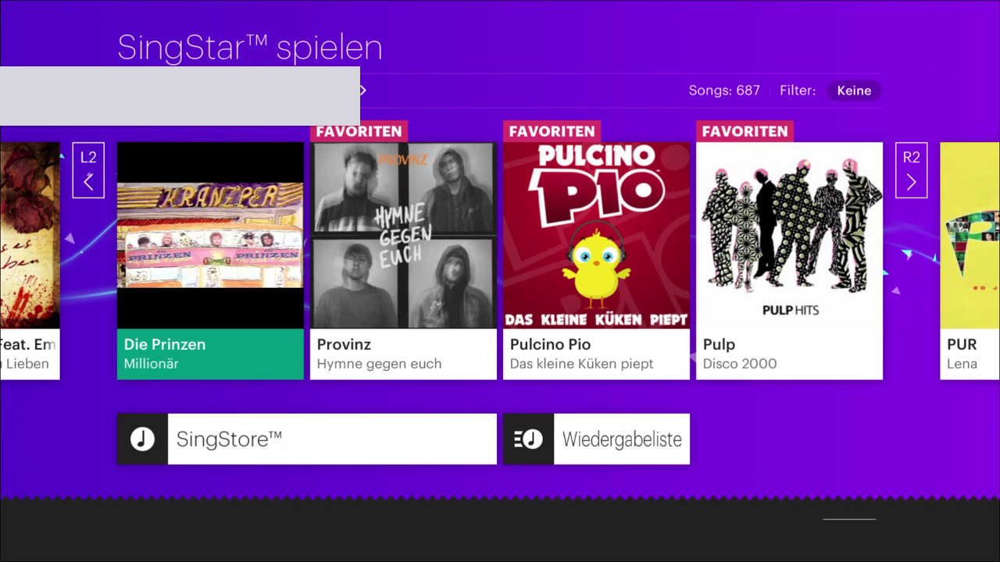
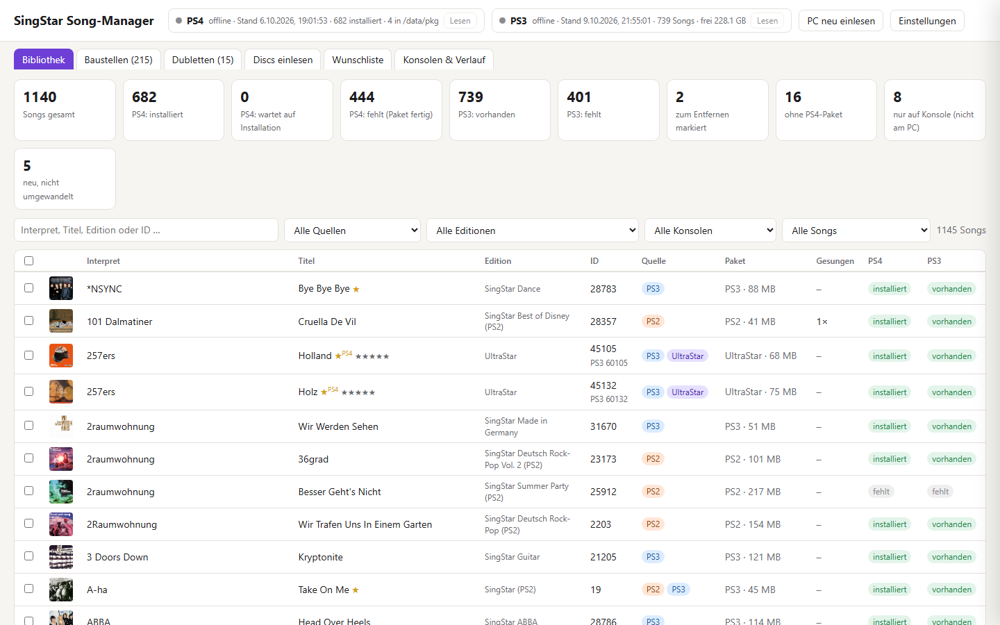
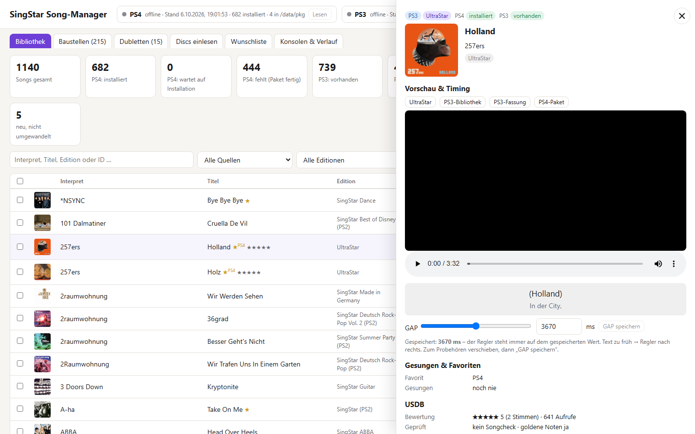
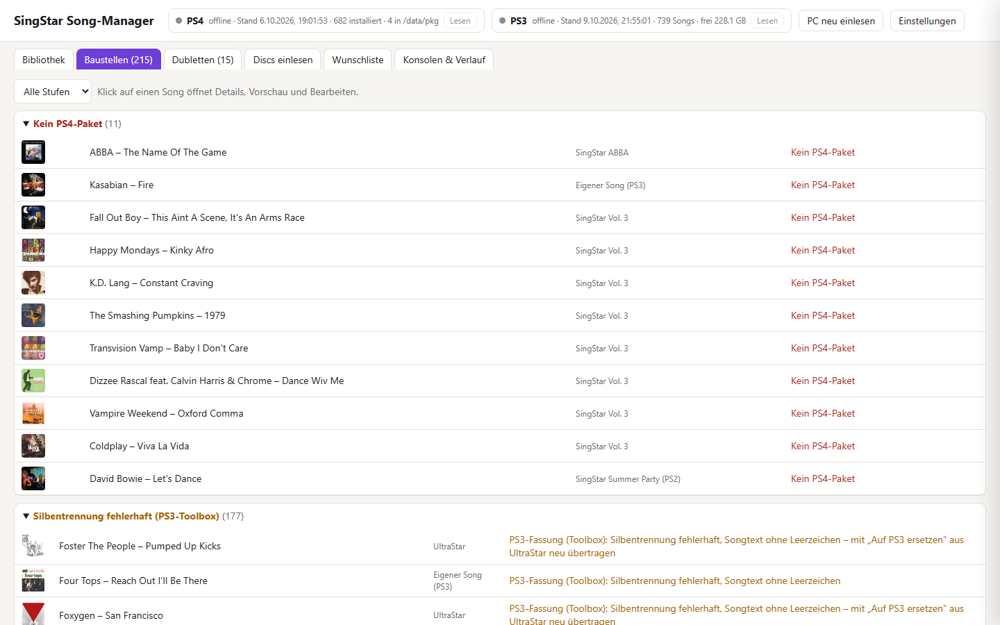
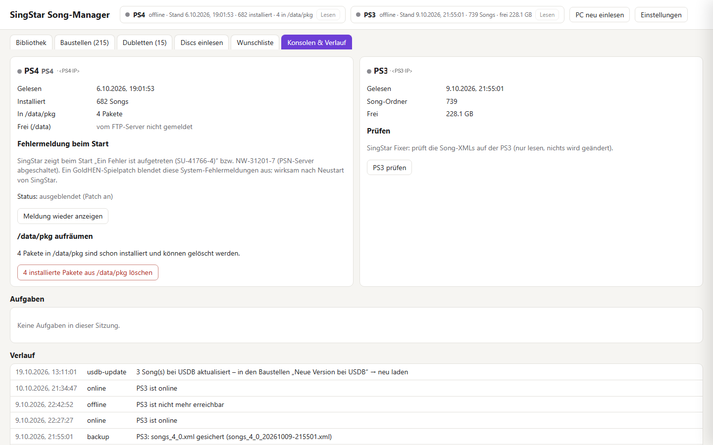

# StarDex

[English](README.en.md) · **Deutsch**

Eigene Songs in **SingStar auf PS3 und PS4** – plus eine Song-Verwaltung, die die ganze Sammlung am PC
zusammenführt.

StarDex wandelt Songs aus **UltraStar**, der **PS3-SingStar-Bibliothek** sowie **PS3- und PS2-Discs** in das
Songformat von SingStar PS3 oder PS4 um und überträgt sie auf die Konsolen. Die Songs erscheinen danach wie
offizielle Songs – mit Text, Tonhöhenlinien, Wertung, Video, Cover, Vorschau und Refrain.

> **Empfehlung: PS3.** SingStar hat auf der PS3 weniger Verzögerung als auf der PS4. Die PS3-Fassung braucht außerdem weniger
> Aufwand: lose Dateien per FTP statt Pakete, kein GoldHEN-Patch, keine Label-Regeln.

> Das Repository enthält **nur Werkzeuge** – keine Songs, keine Pakete und keine Sony-Dateien.
> Nur Songs verwenden, die man selbst besitzt.

## Was es kann

| Bereich | PS3 | PS4 (`CUSA00033`, EU, v01.10) |
|---|---|---|
| UltraStar → Konsole | `tools/to_ps3.py ultrastar` (max. 720p, −10 LUFS) | `tools/us_to_ps4.py` (bis 1080p, −12 LUFS) |
| PS2-Disc → Konsole | `tools/to_ps3.py ps2` | `tools/ps2_to_ps4.py` |
| PS3-Disc / PS3-Bibliothek → Konsole | `tools/to_ps3.py ps3disc` (unverändert übernommen) | `tools/ps3_to_ps4.py` |
| Übertragen | webMAN-FTP nach `/dev_hdd0/FileSystem/Export`, Songlisten mit Sicherung und Prüfung | fPKG über GoldHEN-Paket-Installer oder Disc-Pack (`Pack0.psarc`) |
| Favoriten, Statistik, Bestwerte lesen | ja | ja (bei laufendem SingStar) |

Der **Song-Manager** (`manager/`, Web-App) verwaltet beide Konsolen gleichzeitig: Bibliothek, Problemliste,
Disc-Import, USDB-Wunschliste, Bauen und Übertragen. Details in [manager/README.md](manager/README.md).

### Wie die Konvertierung aufgebaut ist

Die eigentliche Songlogik steckt in den PS4-Konvertern: Noten umrechnen, Duett-Aufteilung, Refrain, Medley,
Gesangsreduktion (ADRS) und Lautheit. Für eine PS3-Fassung von UltraStar- und PS2-Songs baut `to_ps3.py` daraus erst
ein temporäres PS4-Pack und wandelt es dann ins PS3-Format um. Gemeinsamer Schlüssel ist die Song-ID: Offizielle IDs
sind auf allen Konsolen gleich, eigene Songs haben 45xxx (PS4) bzw. 60xxx (PS3).

## Screenshots

Eigene Songs in der Songliste von SingStar auf der PS4:



Song-Manager – Bibliothek mit allen Quellen und dem Status je Konsole:



| Song-Details mit Vorschau und Timing | Baustellen (automatische Problemliste) |
|---|---|
|  |  |

| Konsolen & Verlauf |
|---|
|  |

## Bekannte Probleme

- **Absturz im mehrstimmigen Battle-Modus bei USDB-Songs:** Wird ein von USDB geladener Song im Battle-Modus
  mit mehreren Stimmen gesungen, kann SingStar im Moment noch abstürzen. Bis zur Lösung diese Songs im
  mehrstimmigen Battle-Modus besser meiden.
- Echte UltraStar-Duette (`P1`/`P2`) und `#RELATIVE` werden vom UltraStar-Konverter noch nicht unterstützt.
- PS4: Solange Remote Play verbunden ist, lässt SingStar nicht singen (betrifft nur die Entwickler-Fernsteuerung).

## Schnellstart

1. [Python](https://www.python.org) 3.10+ und [ffmpeg](https://ffmpeg.org) installieren (für die PS4 zusätzlich
   die .NET-Runtime).
2. `start.bat` doppelklicken (Linux/macOS: `./start.sh`) – richtet beim ersten Mal alles ein, bietet den Download von
   PkgTool, scee_london und IPUenc an und öffnet den Manager.
3. Im Manager unter **Einstellungen** die Konsolen eintragen, UltraStar-Songs nach `songs/ultrastar` legen, fertig.

Ausführlich, inkl. Konsolen-Vorbereitung und Kommandozeile: **[docs/SETUP.md](docs/SETUP.md)**.

## Wichtige Regeln

Beide Konsolen:

- **`song_ids.json` behalten:** Darin stehen die vergebenen IDs der UltraStar-Songs. Ohne die Datei bekommt ein Song
  beim nächsten Bau eine neue ID und erscheint doppelt.

PS3:

- **Nicht übertragen, während gesungen wird.** webMAN-FTP ist schnell überlastet. Der Manager liest und überträgt
  bei der PS3 deshalb nur auf Knopfdruck. Nach dem Übertragen SingStar neu starten.

PS4:

- **Paket-Label ↔ Song-ID:** Das Label eines Pakets muss die Song-ID enthalten (`tools/songid.py`), sonst
  verschwinden Songs wieder aus der Liste. `build_dlc.py` prüft das.
- **Dateinamen nicht kürzen:** Pakete nur unter ihrem vollen Namen `EP9000-CUSA00033_00-<LABEL>.pkg` hochladen –
  ein umbenanntes Paket hat die PS4 beim Installieren abstürzen lassen.

## Aufbau

```
manager/          Song-Manager (Flask-Web-App, Port 5077)
tools/            Konverter (PS3/PS4), Paketbau, Disc-Pack, Batch-Läufe
tools/dev/        Entwicklerwerkzeuge: eboot-Analyse, Tests, PS4-Fernsteuerung (remote/)
tools/payload/    GoldHEN-Payload dl0link (Symlink download0/Pack0.psarc)
docs/             Einrichtung, Technik, Formatbeschreibung, Screenshots
songs/            Standardablage für eigene Songs und Disc-Abbilder (bleibt lokal)
song_ids.json     vergebene Song-IDs der UltraStar-Songs (wird beim ersten Bau angelegt, bleibt lokal)
```

## Dokumentation

| Datei | Inhalt |
|---|---|
| [docs/SETUP.md](docs/SETUP.md) | Einrichtung in drei Schritten, Konsolen vorbereiten, Zusatzprogramme, Kommandozeile |
| [docs/FORMAT.md](docs/FORMAT.md) | Song- und Pack-Format von SingStar PS4 (`config.xml`, `melody_1.xml`, `.chc`, Video) |
| [docs/TECHNIK.md](docs/TECHNIK.md) | Technische Hintergründe: wie SingStar Songs lädt, Regeln, Disc-Pack, PS3, Werkzeugliste |
| [manager/README.md](manager/README.md) | Funktionen des Song-Managers |
| [tools/release_readme.md](tools/release_readme.md) | Englische Anleitung für das Weitergabe-Paket (PKG-Weg) |
| [tools/release_discpack.md](tools/release_discpack.md) | Englische Anleitung für den Disc-Pack-Weg |

## Was du selbst mitbringst

- **Deine Songs:** UltraStar-Ordner oder eigene SingStar-Discs. StarDex liefert keine Songs mit.
- **Drittanbieter-Programme:** PkgTool, scee_london und IPUenc lädt StarDex auf Wunsch selbst von GitHub
  (`tools/fetch_tools.py`) – Bezugsquellen und Ablageorte in [docs/SETUP.md](docs/SETUP.md).
- **Deine Einstellungen:** Konsolen und Speicherorte trägst du im Manager ein. Alles, was StarDex erzeugt
  (`songs/`, `build/`, `manager/data/`, `manager/config.json` …), bleibt lokal und wird von Git ignoriert.

## Hinweis

Inoffizielles Hobbyprojekt, nicht mit Sony Interactive Entertainment verbunden. „SingStar“ und „PlayStation“ sind
Marken von Sony. Benötigt eine PS3 mit webMAN (CFW/HEN) bzw. eine PS4 mit GoldHEN; Nutzung auf eigene Gefahr.

## Lizenz

StarDex steht unter der [GNU General Public License v3.0](LICENSE). Separat bezogene Programme (PkgTool, IPUenc,
scee_london) haben ihre eigenen Lizenzen.
